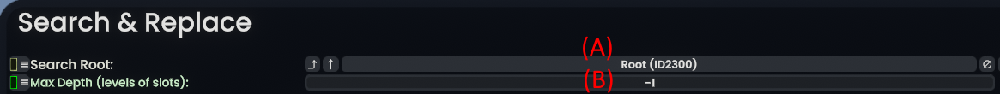
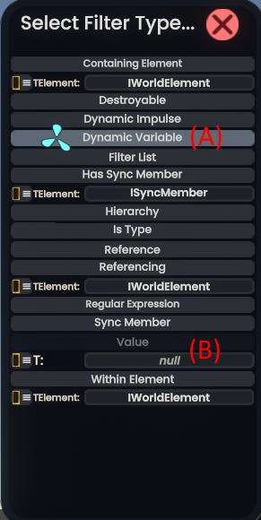
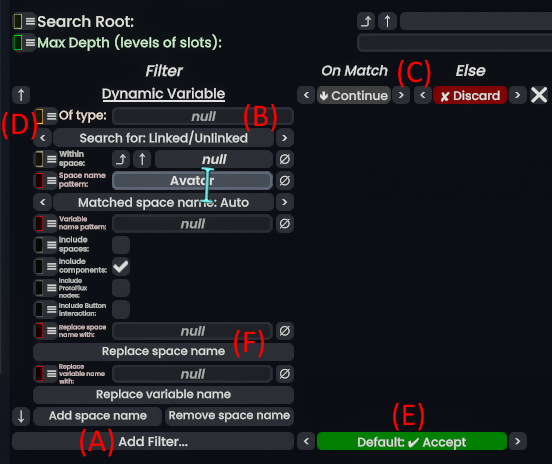
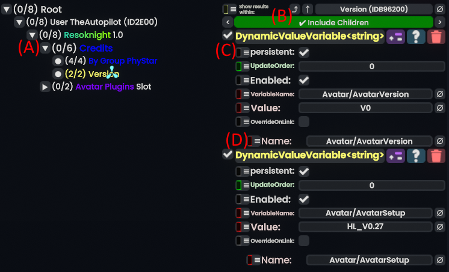

# ResoniteModularSearch

 

This mod for [Resonite](https://resonite.com/) allows searching and editing the world hierarchy based on composable search filters.

The mod itself is modular and it is intended to be extensible via a yet to be published specification. 

Available filters include but are not limited to:
- Values and References
- Regular Expressions
- Dynamic Impulses
- Dynamic Variables

It is possible to compose more complex searches via subqueries.
For example you can find all elements:
- `of type Slot`
- `containing a MeshRenderer`
  - `with a SyncElement` (basic type of a property)
	- `referencing a StaticMesh`

## Installation
1. Install [ResoniteModLoader](https://github.com/resonite-modding-group/ResoniteModLoader)!
1. Place [ResoniteModularSearch.dll](https://github.com/mpmxyz/ResoniteModularSearch/releases/latest/download/ResoniteModularSearch.dll) into your `rml_mods` folder! This folder should be at `C:\Program Files (x86)\Steam\steamapps\common\Resonite\rml_mods` for a default install. You can create it if it's missing, or if you launch the game once with ResoniteModLoader installed it will create this folder for you.
1. Start the game! If you want to verify that the mod is working you can try to open a search window as demonstrated in the next section.

## Usage / Screenshots
1. The mod can only be interacted with when one has builder permissions within a session.
2. Equip Resonite's `DevTool`! (default or custom)
3. There are multiple ways to create a search window:
- Context Menu -> `Create New...` -> `Search & Replace Window`
- If enabled in the settings (default: yes):
  - Context Menu -> `Search from Root`
  - Grabbing a slot -> Context Menu -> `Search from ...`
  - Grabbing a reference -> Context Menu -> `Search for references to ...`
  - Grabbing a value -> Context Menu -> `Search for occurrences of ...`
4. The search can now be customized:
- At the top you can select the object the search starts from (A, `Search Root`) and how many slots deep the search should progress (B, `Search Depth` with -1 as "unlimited" and 0 as "no child slots"): 
  
- Next is the list of filters. You can add a new filter by clicking the button `Add Filter...` (A): 
  
- This will open a window where you can select a filter (A). Some filters have type arguments (B): 
  
- Filters can have a number of options (B) that change how a candidate element is "judged".
  Each filter is applied in the order they appear in the filter list. The resulting action (C) is chosen depending on if the candiate element matches the filter or not: 
  The action can be to `Continue` with the next filter, to `Discard` the element from the search result or to `Accept` it without checking other filters. If no final decision is made until the end of the list a default decision is used (E). 
  As the order between filters is relevant it can by changed using the arrows on the left (D). 
  Some filters offer actions (F) that can be run after a search. 
  
5. Next, run the actual search:
- Click the `Search` (A) button on the bottom of the search configuration panel! A quick summary (B) of the search (or recently run actions) will be displayed below:
  
- The search result looks very similar to a normal inspector panel with the following differences:
  - The hierarchy view (A) only shows slots that contain at least one search result.
    - The slot's names are prefixed with the number of search results `(<# within slot>/<# within slot or children>)`
  - The worker inspector on the right shows only the elements that are part of the search result.
    This can be further narrowed down to a sub-hierarchy or single slot by clicking on an entry within the hierarchy or using the options at the top (B).
    - Slots, components or users are displayed with all their properties.
    - Additional information (D) is displayed depending on the filter. (i.e. the dynamic variable name of `DynamicVariableInput`)
  A major feature is the ability to edit search results. This can be restricted by unchecking the checkbox (C) in front of a result.
  

## Included Filters
This is a mini-documentation on the included filters.

It is possible to create your own filters and actions by including implementations of `IFilter` (with no argument constructor) and `IFilterAction` within another mod. The API may be subject to change, though. Check the implementation of [`ValueFilter`](ResoniteModularSearch/Filters/ValueFilter.cs) if you want to see an example!

### Simple Filters
#### `Destroyable`
#### `Dynamic Impulse`
#### `Dynamic Variable`
#### `Is Sync Member`
#### `Is Type`
#### `Filter List`
#### `Hierarchy`
#### `Reference / Value`
#### `Regular Expression`

### Subqueries
Subqueries are special because they start a _nested_ search for each candidate element.

Nested search results are appended as additional information to the search results.

#### `Containing Element`
#### `Has Sync Member`
#### `Referencing Element`
#### `Within Element`